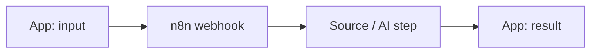

# From idea to plan

Goal: within about 20 minutes the team has a plan in `PLAN.md` that everyone can build from, in stages, each with a test. The teams are technical: you can talk about webhooks, nodes and APIs. The idea belongs to the team; you make it buildable by the submission on Sunday 13:00.

## Steps

1. **Read first:** the challenge from the feed (skill `ttf-challenges`) and the data sources in skill `data-catalog`, so that every stage names real sources.
2. **Understand the idea.** Let the team describe it, then sum it up in two sentences ("So the app does X for Y, using Z?"). Ask only for what is missing, one question at a time, each with your recommendation:
   - **For whom:** who uses the app (guests, a destination team, hotels, the challenge partner)?
   - **Input:** what does someone enter or choose?
   - **Output:** what does the app show or produce?
   - **Data:** which source delivers what (Data Space, open data, DataForSEO, Apify, one.intelligence models)? Is the access real today, or still pending?
   - **Test example:** one concrete case and the result the team expects.
3. **Cut into stages.** Stage 1 runs end to end within about two hours: one input, one source, one result, through a webhook. Every further stage adds one visible thing. The app is its own stage, publishing another one. What does not fit by the submission on Sunday 13:00 goes to "Later".
4. **Show the plan and agree on it.** Ask "Shall we build it like this?" and adjust until the team agrees.
5. **Save and push:** write `PLAN.md`, commit, then `git fetch origin main`, `git rebase origin/main`, `git push origin HEAD:main`. The whole team and every new session can now read it.
6. **Optional check:** offer skill `grill-me` (3 to 5 questions on the plan). Skip it if the team wants to start right away.

## Template for PLAN.md

````markdown
# <App name>

**Challenge:** <number and title>, partner <partner>, contact <person from the feed>
**Idea:** <two sentences>
**For whom:** <users>
**Input:** <what users enter or choose>
**Output:** <what the app shows>
**Data:** <source: what, access status, license>
**Owners:** <who builds the workflow, who the app, who the pitch>

## Stages

1. <Stage 1: webhook, one source, one result>
   Test: <input> gives <expected result>
2. <Stage 2>
   Test: <input> gives <expected result>
3. App: <pages>, accent colour <colour>
   Test: <what you click and what you see>
4. Publish and try it on a phone
   Test: <address> works with the test example

**Names:** workflow "<slot id> · <name>", webhook path `<slot id>-<name>`, Data Table "<slot id> · <name>", if used Supabase table `<slot id with underscores>_<name>` (for example `team_07_places`) and bucket `<slot id>-<name>`
**Later:** <what does not fit by Sunday 13:00>


````

Use the slot id from `team.md` in the names and paths. Mark stages as done (`[x]`) as you go, and add what you learned.

## Rules

- No build before the team agrees to the plan.
- Never invent facts about the challenge, the partner or the data. Write "unknown" or "to check" instead.
- Every stage must be testable with a real example; "it runs" is not a test.
- Prefer a smaller idea that works and is published over a big one that is half done.
- Personal data of real guests does not belong in tests or demos. Public data about businesses and places is fine, within the license of the source.
