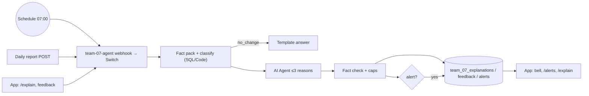

# Change Explainer agent: why did stays drop (or rise)?

**Part of:** Phase 2 of [PLAN.md](PLAN.md). This plan replaces the "Investigate" part of the `team-07 · Drop Watch & Investigate` row there. Campaigns stay where they are in PLAN.md.
**For whom:** the TVB director, marketing and board of Paznaun-Ischgl. They are not data analysts.
**Status:** draft, 2026-11-07 22:00 CET. **Nothing is built until the team agrees.**

## The use case in two sentences

Every day a scheduled call sends that day's visitor report. The agent compares it with the forecast and with last year, decides whether there is a real change, and explains it with **at most 3 reasons**. A big change raises an in-app alert.
Users can also pick any day, week or range and ask "why?". They can then rate the reasons, correct them with their own knowledge, and ask the agent to **reanalyse**, which creates a new version of the explanation.

## 1. What the agent may reason from today

For each day we have only **three numbers**:

| Series | Column in `team_07_stays_daily` | Meaning |
|---|---|---|
| PY | `previous_year` | Stays on the same day last year |
| FC | `forecast` | Stays the forecast expected for this day |
| ACT | `actual` | Stays actually counted (the data ends on 2026-10-31) |

The supporting data we already have is context only, never the main signal: holidays, events, weather, lead time, free beds and the peer index (see PLAN.md).

### Step 1: classify the change (SQL/Code, no AI)

The three numbers give three gaps. Together they give a **change type** that n8n works out before the AI sees anything:

| ACT vs FC | ACT vs PY | FC vs PY | Change type | What it means |
|---|---|---|---|---|
| ≈ | ≈ | ≈ | `no_change` | Nothing to explain. No AI call is made. |
| ≈ | ▼ | ▼ | `expected_drop` | The forecast already expected fewer stays: a calendar or season effect, not a surprise |
| ▼ | ≈ | ▲ | `forecast_too_high` | Stays are like last year; the forecast was too optimistic |
| ▼ | ▼ | any | `real_drop` | Below both forecast and last year: the case that needs reasons and an alert |
| ▲ | ▲ | any | `real_rise` | Above both |
| ≈ | ▲ | ▲ | `expected_rise` | The forecast already expected the rise |
| ▲ | ≈ | ▼ | `forecast_too_low` | Stays are like last year; the forecast was too pessimistic |
| any | any | any | `data_issue` | FC = 0, ACT missing, or `quality_flag = 'red'`. Raises a data alert, not a drop alert. |

"≈" means within ±5 %. The tolerance is a setting in `team_07_settings`.

The change type alone is already the first reason, and it is reliable. "The forecast already expected this drop" is a valid and honest answer.

### Step 2: build the fact pack (SQL, no AI)

The fact pack is a JSON object of numbered facts. Every fact has an `id`, a `label`, a value now, a reference value and a `source`. It includes:
- `f1.*`: the three totals and three gaps, both absolute and in %.
- `f2.*`: a day-by-day comparison for the period, plus the weekday mix (for example 5 Saturdays vs 4).
- `f3.*`: the same-weekday comparison (date − 364) against the PY column, to show weekday shift effects.
- `f4.*` to `f9.*`: context facts from existing tables, only when the table has rows for the period:
  - holidays per market,
  - Easter shift,
  - events and top events,
  - snow and weather,
  - booking lead-time mix,
  - free beds,
  - peer index.

### Step 3: what the AI does (and must not do)

The AI chooses and words **0 to 3** reasons from the fact pack, in plain language.

**Guardrails against invented reasons:**
1. **Evidence refs required.** Every reason must cite ≥ 1 fact id (`evidence_refs`). A reason without a valid ref is dropped.
2. **Number check.** A Code node checks every number in the reason texts against the fact pack, including rounded values and %. A number that does not match is removed and the reason is marked `edited_by_check`.
3. **"Not enough evidence" is a valid answer.** The prompt says: *if the data does not explain the change, say so. Do not guess.* The UI then shows "unexplained" instead of an invented story.
4. **Two kinds of reason.**
   - `data`: backed by a fact. Confidence can be high, medium or low.
   - `hypothesis`: a plausible cause that our data does not cover, for example a lift fault or a road closure. Its confidence is always "low" and it carries a "check this" label.
   - At most 1 of the 3 reasons may be a hypothesis.
5. **Confidence caps (set in Code):**
   - The change type is always high.
   - Context facts are at most medium. There is no market split in the data, so the partner's data alone cannot prove a market effect.
6. **Low temperature (0.2) and a fixed JSON schema** through a Structured Output Parser.
7. **Unexplained remainder.** This is the share of the gap that no `data` reason covers, computed in Code. It is always shown.

## 2. Feedback and reanalysis

Users know things the data doesn't, for example "the Silvretta lift opened a week late". The loop has five parts.

**In the UI:**
- Each reason has 👍 / 👎 and an optional "why wrong?" text. The chips are "wrong cause", "wrong number", "too vague" and "missing context".
- The whole explanation has a free-text field: *"Add context or a suggestion for the agent"*, for example "Check whether the Dutch holidays moved".
- Optional "Ignore this reason" toggles.
- A **Reanalyse** button. This is the one crimson button in the panel.

**In n8n (`action: "regenerate"`):**
1. Load the previous version: fact pack, reasons and all feedback so far for this explanation.
2. **Rebuild the fact pack** from SQL. Never trust the old one, because the data may have been updated.
3. Prompt the agent with three blocks: `FACTS` (verified), `PREVIOUS_REASONS` (with votes) and `USER_FEEDBACK`. User feedback is **context, not fact**:
   - A claim from a user can become a `hypothesis` reason labelled "from your feedback".
   - It can become a `data` reason only if a fact in the pack supports it.
   - A number a user writes is never shown as data.
4. Run the same fact check and caps as above.
5. Save the result as **version n+1** with `parent_id` and a short `change_note` written by the agent, for example "Replaced reason 2 (weather) with the Dutch holiday shift, as you suggested".

**Limits:**
- At most 5 versions per explanation, to protect the shared OI Calls.
- Each feedback text is at most 500 characters.
- Feedback text is passed to the model only inside a delimited block, with the instruction to treat it as data. This guards against prompt injection.

**History:** the UI shows version tabs v1, v2 and so on, with the change note and a small diff ("reason added / removed / reworded").

**Later:** feedback that was confirmed (👍 on a version-2 reason) is reused as a hint the next time the same period or factor comes up.

## 3. n8n workflow: `team-07 · Drop Watch & Investigate`

PLAN.md says to keep the workflow count small, so this is **one workflow, one webhook and a Switch**, plus a schedule.

```
Webhook POST team-07-agent (CORS *) ─► Validate input (Code) ─► Switch on body.action
Schedule 07:00 ─► Set {action: report, date: as_of} ─┘   │
  ├─ 0 report      {date, actual, forecast?}  → stores the report row → Explain chain → alert IF threshold → Respond
  ├─ 1 explain     {scope: day|week|range, date|week|from,to, compare: py|fc} → cache hit? → Explain chain → Respond
  ├─ 2 regenerate  {explanation_id, note?}    → load version + feedback → Explain chain (with feedback) → Respond
  ├─ 3 feedback    {explanation_id, version, reason_idx?, vote, tags[], text} → insert feedback → Respond
  ├─ 4 alerts      {status?}                  → list alerts + unread count → Respond
  └─ 5 alert_status {id, status: read|dismissed} → update → Respond

Explain chain:
  Fact pack (Postgres, fixed parameterised SQL) ─► Classify + score (Code)
   ─► IF change_type = no_change → template answer, no AI
   ─► AI Agent (OpenAI Chat Model → one.intelligence, responsesApiEnabled: false, temp 0.2)
        + Structured Output Parser          [ai_tool slot empty for now; weather API etc. later]
   ─► Fact check + caps + unexplained share (Code)
   ─► Save version (Postgres) ─► Respond
```

- **The report path:** `date` is the day being checked. For the demo, the schedule replays an "as-of" date from `team_07_settings`, because actuals end on 2026-10-31.
- **Cache:** `explain` with the same scope key and the same data `updated_at` returns the latest saved version with no AI call.
- **No raw SQL from the model and no tools that write.** All SQL is fixed, with `$1…` parameters.
- **Errors:** if the AI step fails, the chain answers with the change type and the fact pack, plus `reasons: []` and `error: "ai_unavailable"`. The page still shows the numbers.

**New tables** (`supabase/02_agent.sql`):
- RLS is on, with no anon policy: the app reads everything through n8n.
- The existing `team_07_stays_daily` stays read-only. Reports go into a separate table.

| Table | Key columns |
|---|---|
| `team_07_reports` | `date`, `actual`, `forecast`, `received_at`, `source` |
| `team_07_explanations` | `id`, `scope_key`, `scope` jsonb, `version`, `parent_id`, `change_type`, `facts` jsonb, `reasons` jsonb, `unexplained_pct`, `change_note`, `model`, `created_at` |
| `team_07_feedback` | `id`, `explanation_id`, `version`, `reason_idx` (null = whole), `vote` (-1/1), `tags` text[], `text`, `created_at` |
| `team_07_alerts` | `id`, `explanation_id`, `date`, `change_type`, `delta_pct`, `severity`, `status` (unread/read/dismissed), `created_at` |
| `team_07_settings` | `key`, `value` jsonb (tolerance, alert thresholds, as-of date) |

**Alert rule:**
- `real_drop` with ACT vs PY ≤ −10 % or ACT vs FC ≤ −8 % → severity **high**.
- `real_rise` with the same size → **info**.
- `data_issue` → **warning**.
- The remaining change types (`no_change`, `expected_*`, `forecast_too_*`) raise no alert. Their explanation is saved and appears in the explain history.

**Answer shape** (shared by explain, regenerate and report):

```json
{
  "explanation_id": 12, "version": 2, "versions": [1, 2], "change_note": "…",
  "scope": {"kind": "week", "label": "2026-W16", "from": "2026-04-13", "to": "2026-04-19"},
  "totals": {"actual": 34576, "forecast": 40412, "previous_year": 76824,
             "gap_fc_pct": -14.4, "gap_py_pct": -55.0, "fc_vs_py_pct": -47.4},
  "change_type": "real_drop", "severity": "high",
  "series": [{"date": "2026-04-13", "actual": 0, "forecast": 0, "previous_year": 0}],
  "reasons": [{"rank": 1, "kind": "data", "title": "…", "text": "…", "evidence_refs": ["f5.easter"],
               "confidence": "high", "share_pct": 61, "from_feedback": false, "edited_by_check": false}],
  "unexplained_pct": 24,
  "facts": [{"id": "f5.easter", "label": "Easter Sunday", "now": "2026-04-05", "ref": "2025-04-20", "source": "OpenHolidays"}],
  "feedback_summary": {"up": 1, "down": 1, "notes": 1},
  "model": "…", "created_at": "…", "ai": true
}
```

The `series` row above only shows the format; the real values come from SQL.

## 4. UI: pages, files and style

### Style rules

These follow the **`ischgl-ui` skill**. It was added in commit `4560914` but is not on `main` any more since `3b5e5a6`. Restore it first (stage 0): `git checkout 4560914 -- frontend-starter/.claude/skills/ischgl-ui` and move it to `.claude/skills/ischgl-ui/` so every agent loads it.

- **Tokens and classes:** use only the tokens and classes already in [frontend-starter/app/globals.css](frontend-starter/app/globals.css):
  - layout and text: `container-page`, `eyebrow`, `page-title`, `dash-card`, `dash-card-head`, `dash-h2`, `dash-sub`
  - controls and states: `seg`/`seg-btn` (via `Segmented` in [bits.tsx](frontend-starter/components/dash/bits.tsx)), `gap-chip` (via `GapChip`), `badge-green/yellow/red/gray`, `notice`, `notice-error`, `skeleton`, `spinner`, `source-pill`
  - panels: `drawer`/`drawer-backdrop` (as in [WeekPanel.tsx](frontend-starter/components/dash/WeekPanel.tsx)), `tab-list`/`tab`, `field`, `label`, `table-wrap`
- **Buttons:** one crimson `.btn` per view. That is **"Why?"** on the explain form and **"Reanalyse"** in the feedback panel. The panel is a separate view, because it opens on request. Everything else uses `btn-secondary` or `btn-ghost`.
- **Shapes and type:** square corners, with `cut-corner` on the reason cards. Headings are uppercase and use the display face (Saira). Body text is DM Sans.
- **Chart colours:** ACT `#bb1c3f` solid, FC `#6f747a` dashed, PY `#f59e0b`. The status tokens are `--status-good`, `--status-warning` and `--status-critical`. Reuse the helpers in [chart-utils.ts](frontend-starter/components/dash/chart-utils.ts) and the `viz-tooltip` and `legend` classes.
- **Icons:** lucide-react, 16–20 px. Use `ArrowDownRight` / `ArrowUpRight` for direction, `Bell`, `Sparkles` for AI, `MessageSquare` for feedback, `RotateCcw` for reanalyse, and `ThumbsUp` / `ThumbsDown`.
- **Numbers and motion:** format numbers with `fmtInt` and `fmtSignedPct` from [lib/dashboard.ts](frontend-starter/lib/dashboard.ts) (en-US). All motion respects `prefers-reduced-motion`. The layout works at 375 px, and the drawer and toast work with the keyboard (Esc closes them).
- **Label AI text clearly.** The dashboard footer says "nothing on this page is generated by AI". On the agent pages, every reason card shows a small `Sparkles` "AI wording · numbers checked" line, and the numbers come from `totals` and `facts`.

### Screens

**A. Alert bell and toast** (every page, in [Header.tsx](frontend-starter/components/Header.tsx))
```
[logo | PAZNAUN-ISCHGL …]      OVERVIEW  EXECUTIVE COCKPIT  EXPLAIN  ALERTS  [🔔 2]
                                                       ┌──────────────────────────┐
                                                       │ ▼ −55 % · 2026-W16  HIGH │ toast, 8 s,
                                                       │ Real drop · 3 reasons    │ role=status
                                                       │ [Open] [Dismiss]         │
                                                       └──────────────────────────┘
```

**B. `/alerts` inbox**
```
EYEBROW: AGENT ALERTS
ALERTS ▬                                   [All|Drops|Rises|Data]   [Run check now]
┌────────────────────────────────────────────────────────────────────────────┐
│ ● ▼ −55.0 %  2026-W16  [HIGH]  Easter fell two weeks earlier   v2  unread │
│ ○ ▲ +95.9 %  2026-W14  [INFO]  Easter holidays fell in this week   read   │
│ ○ ⚠ data     2025-W45  [WARN]  2 days without forecast             read   │
└────────────────────────────────────────────────────────────────────────────┘
```
"Run check now" is a demo button that sends `action: report` for the as-of date. On this page it is the one crimson button.

**C. `/explain` (also `/alerts/[id]`, same view)**
```
EYEBROW: CHANGE EXPLAINER
WHY DID STAYS CHANGE? ▬
[Day|Week|Range]  [2026-W16 ▾]  compare [Last year|Forecast]          [WHY?]
┌ dash-card ─────────────────────────────────────────────────────────────────┐
│ ACTUAL 34,576   vs FORECAST 40,412 [▼ −14.4 %]   vs LAST YEAR 76,824 [▼ −55.0 %] │
│ Change type: REAL DROP — below forecast and last year        [HIGH]       │
│ [chart ±3 weeks: ACT solid crimson, FC dashed grey, PY amber; period shaded] │
└────────────────────────────────────────────────────────────────────────────┘
VERSIONS  [v1] [v2 ●]   "Replaced weather with Dutch holiday shift, as you suggested"
┌ cut-corner card ─────────────────────────────────────────────── 1 ┐
│ EASTER FELL TWO WEEKS EARLIER            [DATA] [HIGH]  ████████ 61 % │
│ Easter Sunday was 5 Apr 2026 vs 20 Apr 2025, so the holiday week   │
│ moved out of W16.                                                   │
│ Evidence: [Easter Sunday 2026-04-05 vs 2025-04-20 · OpenHolidays]   │
│ ✦ AI wording · numbers checked                        [👍] [👎] [✎] │
└─────────────────────────────────────────────────────────────────────┘
│ 2 …  [DATA] [MEDIUM] │ 3 …  [HYPOTHESIS · from your feedback] [LOW] │
Unexplained remainder  ███░░░░░ 24 %     ⓘ the data cannot explain this part
┌ Feedback panel ────────────────────────────────────────────────────────────┐
│ What did the agent miss? [textarea, 500 chars]                            │
│ chips: [wrong cause] [wrong number] [too vague] [missing context]          │
│ ☐ ignore reason 2                                       [↻ REANALYSE] (4 left) │
└────────────────────────────────────────────────────────────────────────────┘
Sources · model · created 07:00 · v2 of 2
```

**D. From the dashboard:** [WeekPanel.tsx](frontend-starter/components/dash/WeekPanel.tsx) gets a "Why did this week change?" `btn-secondary` that links to `/explain?week=2026-W16`. Clicking a day in [DemandChart.tsx](frontend-starter/components/dash/DemandChart.tsx) can later link to `/explain?date=…`.

**States:**
- Loading: `skeleton` cards plus "The agent is checking 3 numbers and the context …".
- `no_change`: a `notice` with the totals and no reason cards.
- `ai_unavailable`: the numbers and change type, plus a `notice-error` "Reasons could not be written; numbers are correct".
- `data_issue`: a `badge-yellow` and a link to the Data health tab.
- Offline: a demo snapshot with the "Demo snapshot" `source-pill`, as on the dashboard.

### Files

New files (all in `frontend-starter/`):

| File | What |
|---|---|
| `lib/agent.ts` | Types (`Explanation`, `Reason`, `Fact`, `ChangeType`, `Feedback`, `Alert`), `AGENT_WEBHOOK = "team-07-agent"`, `explain()`, `regenerate()`, `sendFeedback()`, `listAlerts()`, `setAlertStatus()` via `callWebhook()` from [lib/n8n.ts](frontend-starter/lib/n8n.ts), demo fallback |
| `lib/useAlerts.ts` | Polls `alerts` every 60 s and pauses while the tab is hidden; exposes `unread` and `latestNew` for the toast |
| `lib/useExplanation.ts` | Loads, regenerates and switches versions; aborts on unmount, like `useDashboard.ts` |
| `app/explain/page.tsx` | Form plus `ExplanationView`; reads `?date=`, `?week=`, `?from=&to=` |
| `app/alerts/page.tsx` | Inbox with filter `Segmented` and "Run check now" |
| `app/alerts/[id]/page.tsx` | Loads the alert, marks it read, renders `ExplanationView` |
| `components/agent/ExplainForm.tsx` | Scope `Segmented`, date/week/range `field`s, compare toggle, `.btn` "Why?" |
| `components/agent/ChangeSummary.tsx` | Three totals with `GapChip`s, change-type label and severity badge |
| `components/agent/PeriodChart.tsx` | Small SVG line chart of ACT/FC/PY over ±3 weeks, following `DemandChart` and `chart-utils` |
| `components/agent/ReasonCard.tsx` | Rank, title, text, kind/confidence badges, share bar, evidence chips, vote buttons |
| `components/agent/EvidenceChips.tsx` | Fact label, now vs ref and source; tooltip with the full fact |
| `components/agent/UnexplainedBar.tsx` | Share bar and explanatory note |
| `components/agent/VersionTabs.tsx` | v1…vn using `tab-list`, change note, simple diff |
| `components/agent/FeedbackPanel.tsx` | Textarea, tag chips, ignore toggles, "Reanalyse" with a remaining-count, sending state |
| `components/agent/ExplanationView.tsx` | Composes Summary, Chart, Versions, Reasons, Unexplained, Feedback and Sources |
| `components/agent/AlertBell.tsx` | Bell with unread `badge-red` count; links to `/alerts` |
| `components/agent/AlertToast.tsx` | `role="status"` toast for a new alert |
| `components/agent/AlertList.tsx` | Rows for the inbox, `row-btn` style |
| `public/demo/explain-2026-W16.json` | Saved real answer for offline demos, recorded after stage 2 |

Changed files:

| File | Change |
|---|---|
| [components/Header.tsx](frontend-starter/components/Header.tsx) | NAV gets "Explain" (`/explain`, icon `Sparkles`) and "Alerts" (`/alerts`, icon `Bell`); add `AlertBell` and `AlertToast` |
| [components/dash/WeekPanel.tsx](frontend-starter/components/dash/WeekPanel.tsx) | "Why did this week change?" link |
| [app/globals.css](frontend-starter/app/globals.css) | Small additions only, built from existing tokens: `.reason-card` (`cut-corner` + `dash-card`), `.conf-pill`, `.evidence-chip`, `.share-bar`, `.toast`, `.bell-count`, `.vote-btn[aria-pressed]` |
| [app/dashboard/page.tsx](frontend-starter/app/dashboard/page.tsx) | Relabel the "Coming next" `WhyWaterfall` preview as "Live in Explain →" once stage 3 is done |

## 5. Stages and tests

It is Sat 22:00 and submission is Sun 13:00. Every stage ends with a real test and a publish.

- [ ] **0. Setup (15 min).** Restore the `ischgl-ui` skill, then write and run `supabase/02_agent.sql`.
  *Test:* the 5 tables exist with RLS on, and an anon `select` returns 0 rows.
- [ ] **1. Numbers only (1.5 h).** `team-07-agent` with `explain`, the fact pack SQL and classify + score. No AI.
  *Test:*
  - `{action: explain, scope: week, week: "2026-W16"}` gives ACT 34,576, FC 40,412, PY 76,824 and `real_drop`, with an Easter fact present.
  - `2026-W14` gives `real_rise` (+95.9 % vs PY).
  - `2025-W45` gives `data_issue` (red days).
- [ ] **2. Agent + fact check (1.5 h).** AI Agent, parser, number check, caps, unexplained share, save version 1.
  *Test:*
  - W16 gives 1 to 3 reasons, each with a valid `evidence_refs`, and every number in the text is found in `facts`.
  - A day with `no_change` makes 0 AI calls (check the execution).
  - Asking for W16 again is a cache hit (no AI node in the execution).
- [ ] **3. Explain UI (2 h), then publish.** `/explain`, `ExplanationView`, the WeekPanel link and the demo JSON.
  *Test:* on a phone at 375 px, Dashboard → week W16 → "Why?" shows the three totals, the chart and the reasons.
- [ ] **4. Feedback + reanalyse (1.5 h), then publish.** `feedback` and `regenerate` actions, `FeedbackPanel` and `VersionTabs`.
  *Test:*
  - 👎 on reason 2 with the text "Dutch holidays moved, check NL" → Reanalyse gives version 2, a `change_note`, reason 2 replaced or marked `from_feedback`, and v1 still visible.
  - The 6th reanalyse is refused with a clear message.
- [ ] **5. Report + alerts (1.5 h), then publish.** `report`, `alerts` and `alert_status` actions, the schedule, bell, toast, `/alerts` and `/alerts/[id]`.
  *Test:*
  - `{action: report, date: "2026-04-15", actual: 4000}` creates 1 unread high alert, and the bell shows 1 within 60 s.
  - Opening the alert marks it read.
  - `2026-04-15` with ACT = FC = PY creates no alert.

### Status (2026-11-07, 22:35 CET): stages 0–5 built, tested against the live webhook, not pushed yet

- **n8n:** `team-07 · Drop Watch & Investigate` (id `jp4B3XEazJbdSx8G`) is active. It has 19 nodes, saved to `workflows/agent.json`.
  - The node sources are in `workflows/agent-sql/*.sql` and `workflows/agent-code/*.js`. Change them there, then patch the node.
  - Model: `gpt-4.1-mini` through "TTF one.intelligence", temperature 0.2. One AI call per new explanation; cache hits, `no_change` and `data_issue` make none.
- **SQL parameters:** every Postgres node gets one parameter, `$1`, a base64 JSON string built in Code. The Postgres "Query Parameters" option is comma-separated, so this is the safe way to pass user text.
- **Tested with real data:**
  - **W16:** `real_drop`, high severity. Reasons: Easter shift (expected part, 86 %), bookings −28.9 % plus free beds +51.8 % (forecast miss), events and weather (medium).
  - **W14:** this is `expected_rise`, not `real_rise`, because actual was only −1.5 % vs forecast. The forecast already expected the Easter peak.
  - **W45 2025:** `data_issue`, no AI call.
  - **Cache:** asking for W16 again is a cache hit.
  - **Reanalysis:** v2 replaced the weather reason, as the feedback asked. In v3 the user's "lifts closed earlier" became a `hypothesis` marked "from your feedback", with low confidence.
  - **Report:** `report {date: 2026-04-15, actual: 4000}` created an alert; repeating it creates no duplicate.
  - **Feedback** saves; a bad week answers 400.
- **Learned:**
  - Without the rule "a reason must cite a context fact", the model only restated the forecast.
  - Fact IDs leaked into the text; `Finalize` now removes them.
  - A hypothesis may point only at `f1.change_type`.
- **Demo:** the as-of date is now `2026-04-19` (a real drop), so "Run check now" raises an alert. The saved answer is in `public/demo/explain-2026-W16.json`.

### Ranked findings (2026-11-08, 00:30 CET): the reasons are computed and ranked before the AI

- **What changed:**
  - `Build facts` now turns the data into candidate **findings**. Each one gets `score = share of the change it addresses × strength of the signal (0–1) × reliability of the source (0–1)`.
  - Only the best finding per group is kept. The top 3 go into the prompt as `RANKED_FINDINGS`.
  - The AI only words them. `Finalize` forces the rank order, the evidence and the confidence. If the AI skips a finding, or writes numbers that are not in the facts, the computed `statement` is shown instead (`worded_by: "n8n"`).
  - The answer now has `findings` (all of them, with `rank`, `score` and `status`) and `logic: "findings-v1"`. Cached answers without that logic are recomputed.
- **Findings and their reliability:**
  - Calendar: Easter shift (1.0), merged with school holidays when they point the same way. School holidays on their own: 0.6.
  - Demand: bookings plus free beds (0.9).
  - Where the forecast miss happened (0.8, or 0.5 when spread over most days): Friday–Sunday against Monday–Thursday, a few days, or most days.
  - Weather (0.5), events (0.4) and peer regions (0.4).
  - "The forecast already expected it" (0.5), only when no cause covers the expected part.
- **What counts as an explanation:**
  - Findings that only locate the change are `covers: false`: days, peers and "forecast expected".
  - They are shown, but they do not reduce `unexplained_pct`.
- **Reanalysis:**
  - Findings behind rejected reasons (👎 or "drop") are removed.
  - Findings that match a user's words (snow, weekend, booking, holiday, a market code …) get ×1.5 and `from_feedback: true`.
  - Then only the top 2 are used, so the AI has room for one hypothesis.
- **Tested live:**
  - **W16:** Easter shift 0.86 → weaker demand 0.126 → shortfall Friday–Sunday 0.105 (96 % of the miss; Sun 19 Apr is flagged yellow). The model wrote all three in rank order and the number check changed nothing. The live answer equals the local test of the same code field by field.
  - **2026-W03:** `no_change`, no AI call, findings only listed.
  - **2025-W49:** v1 → v2 → v3 with "bookings rejected, look at the weekend". The rejected finding dropped out and "above the forecast on most days" moved up, marked `from_feedback`.
  - **Sweep:** 134 weeks, days and months run without errors, and every cited fact exists. Test data: explanations 27–32; 32 is a clean new W49 answer, so the cache does not serve the test reanalysis.
- **Known limit:** gpt-4.1-mini does not reliably add an uncovered user suggestion (for example "early snow") as the hypothesis, even when told to.

**Cut first if late:** the schedule trigger (keep "Run check now") → the version diff (keep tabs) → the toast (keep bell) → `/alerts/[id]` (open the alert in `/explain`).
**Never cut:** stages 1 to 4. The numbers, the max-3 reasons and the feedback loop are the demo.

## 6. How to make it better (later)

1. **More tools for the agent.** Plug them into the empty `ai_tool` slot as sub-workflows:
   - GeoSphere/Open-Meteo forecast and snow,
   - OpenHolidays for future months,
   - live Contwise events,
   - lift opening dates,
   - DataForSEO search demand per market (paid, so cache it).
   With each tool, more reasons can become `data` instead of `hypothesis`.
2. **Forward-looking alerts.** Run the same check on forecast vs last year plus booking pace for winter 2026/27, so the warning comes *before* the drop. This is the strongest point for the partner.
3. **Counterfactuals in SQL.** For example, "Without the Easter shift, W16 would be about −8 %", computed by aligning holiday weeks, not guessed by the AI.
4. **Learning from feedback.** Confirmed feedback becomes few-shot hints. A "reason library" of reasons the board confirmed is shown next to new explanations of the same type.
5. **Reason → action.** Each confirmed reason type maps to a campaign playbook. This is the link to the campaign stages in PLAN.md.
6. **Weekly digest by email**, using the planned `team-07 Mail` credential, plus a Monday briefing built from the week's explanations.
7. **Evaluation.** Use `n8n_evaluations` with a small set of known weeks (W14, W16, W45, a summer week) to see whether a prompt or model change makes the reasons better or worse.



## Reasoning engine (logic `drivers-v2`, 2026-11-08)

**Why:** reasons used to come from hand-weighted rules. Bookings and free beds were presented as causes, though they are the drop itself seen from the booking side. Weekday patterns were shown as "why", and forecast noise was explained as a signal. The last-year column is by **calendar date**, so every comparison was shifted by one weekday.

**Now:** the reasons are the measured contributions of an explainable driver model (`scripts/fit_driver_model.py`, pure Python).
- **Model:**
  - log(stays) = season dates + smooth season curve + weekday + holiday calendar (Easter, Christmas/New Year, school holidays DE/NL/BE/CH/UK/AT) + new snow + season level;
  - fitted on 727 days (2024-11-04 → 2026-10-31; 2024/25 from the last-year column, which is the actual on the same date a year earlier).
- **Backfill:** `scripts/migrate_to_supabase.py --enrich` now loads holidays and weather from 2024-09.
- **Fit quality:** R² 0.90; leave-one-week-out error 11 % in season (Jan 5 %, Dec 8 %, Mar 9 %, Apr 34 %). The April figure reflects only two Easters in the data.
- **Attribution in n8n** (Build facts, block also in `workflows/agent-code/drivers_block.js`):
  - The change vs the **same weekdays** last year (date − 364) is split per driver in stays, with a 90 % range from 120 block-bootstrap fits.
  - A driver is a reason only if its range excludes 0 and the effect is large enough.
  - The **weekday shift** (calendar date vs same weekday) is a reason of its own.
  - Forecast-only periods use coefficients fitted on the forecast ("why the forecast expects this"); the rest is "what the forecast assumes beyond the calendar".
- **Observations, never reasons:**
  - bookings, free beds, which days (Fri–Sun, a few days);
  - forecast noise (|miss| below the month's p80 forecast error);
  - data flags.

  They are listed under "Also seen in the data"; drivers with no effect are under "Checked, no effect".
- **Unexplained %** = change − weekday shift − significant driver effects. It is measured, not a coverage flag.
- **The LLM still only words** the computed statements (the team's guards stay in Finalize).
- **Tables:** `team_07_driver_model`, `team_07_features_daily`, `team_07_season_dates` (`supabase/04_driver_model.sql`, RLS on).
- **UI:** `components/agent/DriverBreakdown.tsx`, with a waterfall, ranges and model accuracy, inside `ExplanationView`.
- **Evaluation:** `python3 scripts/eval_agent.py` checks 9 labelled cases (`workflows/agent-eval/cases.json`): top reason correct 9/9, symptoms as reasons 0/9.
  - **3 May 2026:** the old "−10,556 drop" is entirely a weekday shift; +91 vs the same weekday.
  - **2026-W14:** 98 % explained, by the holiday calendar and the weekday shift.
- **Refit** after new actuals: `python3 scripts/fit_driver_model.py` (writes a new active version).

## Forecast first, then last year (logic `drivers-v5`)

- **Reasons = actual vs forecast**, at most 3, each tagged `vs: "fc"`:
  - candidates: where the gap fell, bookings and free beds, weather, events, peers, data flags;
  - "within the normal forecast error" is itself a candidate, ranked by the usual score.
  - Forecast-only periods keep the old behaviour (driver reasons, forecast vs last year).
- **`vs_py` block = actual vs last year:**
  - `main_point`: the single largest measured cause (driver group or weekday shift), with its 90 % range;
  - `note` (AI-worded, number-checked, n8n text as fallback);
  - `other_measured`, `unexplained`, `ruled_out` ("Checked, no effect").
- **UI:** the "Why it happened · actual vs forecast" list and the "Against last year" card (`DriverBreakdown` with `vsPy`). The "Compared with" toggle is gone.
- **Live tests (8 Nov):**
  - **W16:** 3 forecast reasons (bookings/free beds, Fri–Sun, noise); main last-year point is the holiday calendar (−32,682).
  - **W14:** 2 forecast reasons; main point is the holiday calendar (+49,628).
  - **W15:** no_change.
