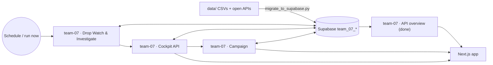

# Demand Detective

**Challenge:** 04 – Overnight Data Without Explanation, partner TVB Paznaun-Ischgl, contact Raphael Tonitz
**For whom:** TVB managing director, marketing team and board (not data analysts)
**Data:** TVB stays, free beds, lead time and events (TTF Space, downloaded to `data/`, not committed); Contwise Paznaun content (events with village and top-event flag, hosts with beds; CC-BY items only, no contact fields); JOANNEUM regional index (open); OpenHolidays (ODbL); Open-Meteo (CC BY 4.0).
**Owners (proposal):** A = data and SQL, B = n8n analysis and actions, C = frontend, D = AI texts and pitch

## The product

An AI demand agent for the tourism director, not just a dashboard:

1. **Watch, automatically.** n8n checks the data on a schedule. When it spots a hint of a drop (forecast
   below last year, slow bookings, many free beds, actual below forecast), it raises an **alert**.
2. **Explain why.** The alert wakes an AI agent, which pulls facts from Supabase (holidays in the source
   markets, Easter shift, weather, events, peer regions, booking lead time, data gaps) and explains the
   drop with evidence and a confidence level.
3. **Suggest campaigns.** The agent proposes 2–3 ranked campaigns: market, audience, week, village/event,
   a deadline set by the booking lead time, expected effect.
4. **The director decides.** Accept a proposal, write an own strategy, or dismiss. Notified in an **in-app
   inbox and by email**.
5. **n8n runs the campaign.** The chosen strategy becomes a campaign pack (audience spec, texts per market
   and language, a step schedule). A runner carries out the steps on time as a **demo send** to a test
   inbox plus a log in the app — no real guests are contacted: there are no guest contacts in the data,
   and the rules forbid personal data.

**Principle:** numbers come from SQL or Code; only words come from the AI, and every number the AI writes is
checked against the tool output before it is shown.

## Rules from the data check (overrule the spec)
- Names: Supabase `team_07_*` (not `t07_`), workflows `team-07 · …`, webhooks `team-07-…`.
- `available_beds` = free beds left. Occupancy proxy = actual / (actual + free beds).
- No market data: market actions rest on holiday calendars plus assumed shares, max confidence "medium".
- Actuals end 2026-10-31. Past weeks are explained; winter 2026/27 (forecast only) gets the actions.
- Numbers come from SQL/Code. The AI only writes text, and the numbers in that text are checked.
- **Keep the number of n8n workflows small** — merge related jobs into one workflow with several
  triggers/branches rather than one workflow per webhook; fewer workflows are easier for the team to
  maintain and hand off between people.

## Phase 1 — Live dashboard (done)

Goal: show the real Supabase data on the dashboard, through n8n, before building the agent. No new
workflow — the existing `team-07 · API overview` now answers everything the dashboard needs.

- **Data (`scripts/migrate_to_supabase.py`):** one script loads schema + all CSV/Contwise data into
  Supabase (village names normalised, duplicates like "See, Paznaun" / "Galtür " removed), and two new
  flags:
  - `--enrich` loads OpenHolidays (7 markets + hardcoded UK) and Open-Meteo weather for Ischgl (archive +
    16-day forecast) — ported from the old `team-07 · Enrich` workflow into Python so it no longer needs a
    separate n8n run.
  - `--verify` runs `scripts/verify_supabase.sql` and prints row counts / KPIs to check the load.
- **n8n (`team-07 · API overview`, `GET team-07-overview`):** the Postgres query was extended (same
  3-node workflow: Webhook → Postgres → Respond) to also return holidays-by-week per source market,
  events-by-week, weather-by-week, the booking-lead-time mix, and the peer-region index, next to the
  existing days/weeks/KPIs/quality/village-beds. Published and tested live; saved to
  `workflows/api-overview.json`.
- **App (`frontend-starter/app/dashboard`):** rebuilt around six tabs — Overview (KPI tiles, demand
  timeline with hover + click-to-detail, biggest drops, beds by village, booking window), Weeks (sortable
  table), Holiday calendar (heatmap), Peers ("just us or everyone?"), Data health (red/yellow days), and
  Coming next (the old sample-data modules, relabelled as a Phase 2 preview). Falls back to a saved
  snapshot (`frontend-starter/public/demo/overview.json`) with a visible "Demo snapshot" badge when n8n
  doesn't answer, so the app never goes blank in a demo. Chart colours follow the team's validated
  data-viz palette (categorical/sequential/status roles, not ad-hoc colours).
- **Verified:** `npm --prefix frontend-starter run build` is green; the live webhook returns 517 days /
  74 weeks, winter 2025/26 actual 2,349,142 vs forecast 2,409,874 (−2.5 %), PY +0.8 %, 17 red days; the
  dashboard renders this live at `http://localhost:3000/dashboard` with a "Live from n8n" badge, and still
  renders from the demo snapshot when the webhook is unreachable.

## Phase 2+ — The agent (next)

> **Phase 3, campaign strategies:** [STRATEGY_PLAN.md](STRATEGY_PLAN.md). Workflow `team-07 · Campaign Strategist`
> (POST `team-07-strategy`): max 3 strategies + your own idea, reanalyse, choose; pages `/strategies`.
>
> **Detailed plan for the explain part (draft, to agree):** [AGENT_PLAN.md](AGENT_PLAN.md) — Change Explainer
> agent (max 3 reasons from PY / forecast / actual + context), feedback and reanalyse, alerts, UI files.

Keep the workflow count small by merging the 12 roles discussed into 4 workflows:

| Workflow | Merges | Job |
|---|---|---|
| `team-07 · API overview` | overview + week/calendar/quality explorer | all read-only dashboard data (Phase 1, done) |
| `team-07 · Drop Watch & Investigate` | schedule watcher + data tools + AI agent + campaign suggestions | daily schedule / run-now → signal SQL (forecast vs PY, booking pace, unsold beds, actual vs forecast, data gaps) → on a hit: AI agent explains the drop using fixed Postgres tools (never raw SQL from the model) → deterministic driver split + rule-based candidate campaigns, ranked by an LLM step that may not change the numbers → email + alert status |
| `team-07 · Cockpit API` | alerts/campaigns read API + the director's decision | `GET team-07-alerts`, `GET team-07-alert`, `GET team-07-campaigns`, `GET team-07-campaign`; `POST team-07-decision` (accept proposal / own strategy / dismiss) |
| `team-07 · Campaign` | campaign builder + 15-min runner + notify | turns the decision into an audience spec + dated step schedule + per-language texts; a schedule sends due steps as a demo send to a test inbox, logs them, and closes the campaign when done |

New Supabase tables (`supabase/02_agent.sql`, all with RLS): `team_07_alerts`, `team_07_diagnoses`,
`team_07_proposals`, `team_07_campaigns`, `team_07_campaign_steps`, `team_07_settings` (watcher thresholds,
alert email).

New UI pages: `/alerts` (inbox, severity + status, "Run check now" for the demo), `/alerts/[id]` (the
signal, the Why waterfall with evidence, 3 ranked proposals, an "own strategy" form, dismiss),
`/campaigns` (list with progress), `/campaigns/[id]` (brief, audience spec, step timeline, "Run due steps
now" demo button).

**Build order:** `02_agent.sql` → Drop Watch's deterministic signal SQL + driver split (test against
2026-W16: PY 76,824 vs actual 34,576, drivers + unexplained must sum exactly to the gap) → the AI
investigate step (fact-checked against tool output) → campaign suggestions → Cockpit API + `/alerts` pages
→ Decide + Campaign Builder + `/campaigns` pages → Notify (needs a team member to create an SMTP/Gmail
credential named `team-07 Mail` in the n8n editor) → Runner.

**Cut first if time is short** (in this order): watcher settings page → runner schedule (keep the built
campaign pack) → email (inbox only) → separate week-explorer pages. **Never cut:** Drop Watch →
Investigate → Suggest → Decide → Builder, and the `/alerts` + `/campaigns` pages — that is the whole demo
path.

## Housekeeping / open items
- `team-07 · SQL` is active with a public webhook that runs arbitrary SQL — deactivate it outside of
  migrations (skill `n8n-security-audit`), and save it to `workflows/sql.json` (currently missing).
- `team-07 · Enrich` is superseded by `scripts/migrate_to_supabase.py --enrich` — safe to rename to
  `team-07 · OLD Enrich` or leave inactive.
- A stray, empty root-level `package-lock.json` (no root `package.json`) was confusing Next.js's
  workspace-root detection; removed locally — do not recreate it (always `npm --prefix frontend-starter
  ...`, never plain `npm ...` from the repo root).

## Reason tool (stage 1, webhook)

- **Webhook:** `POST team-07-reason-tool` with `{"date": "YYYY-MM-DD", "location": "Ischgl", "difference": -1200}` (difference = actual minus forecast, in guest nights).
- **Sources (free, no key):** OpenHolidays (school and public holidays for Tyrol, state code `AT-TI`), Open-Meteo (temperature, precipitation, snow for the location, forecast horizon about 16 days).
- **Reasoning (rules, no AI):** each candidate reason gets an influence (positive or negative) and a weight. The tool returns the three strongest, and marks whether each one supports the observed direction of the difference.
- **Test:** 2026-11-14, location Ischgl, difference -1200. Expect a list of up to three reasons and a list of data gaps.
- **Not in stage 1:** regional trend (overnight stay forecast API, region code to be looked up), events and booking pace (Supabase), and AI wording.
- **Built and tested (7 Nov 2026):** workflow `team-07 · Reason tool` (ID `QcmGs5Ha0SB8CKk0`), active, saved as `workflows/reason-tool.json`. Test 2026-11-14 (Saturday, -1200): one reason (weekday pattern), no gaps. Test 2026-12-26 (+900): school holidays, public holiday, weekday pattern; weather reported as a data gap (beyond the 16-day forecast).
- **Open:** stage 2 adds the regional trend (overnight stay forecast, Tyrol region code), events and booking pace from Supabase. Weather for dates beyond 16 days needs the archive API.

## Alert rules (subscriptions) — forward-looking, built 8 Nov 2026

- **Principle:** alerts must lead to an action, so every rule looks from **today** into the coming season
  (past drops stay on `/explain` and under "Past drops (explained)"). "Today" = `current_date`, or the setting
  `rules_today` in `team_07_settings` to pin a demo date.
- **Dropdown on `/alerts` (three rule types):** a coming week looks weak (forecast vs last year, default 8 %; the
  alert names the source markets on school holiday that week); bookings slowing down (latest week vs 4-week average,
  only with ≥ 100 bookings); forecast missing (days in the next 56). Catalogue: `RULE_TYPES` in
  `frontend-starter/lib/agent.ts`; maths: `workflows/agent-sql/check_rules.sql`; DB: `supabase/05_three_alert_types.sql`.
- **Act-by date:** half of all bookings come ≥ 31 days ahead (`team_07_lead_time`), so act by = week start − 31 days;
  after that the alert says how much of the bookings usually still comes in (last-minute offers).
- **Data:** `supabase/03_alert_rules.sql`, `04_action_alert_rules.sql`, `05_three_alert_types.sql` (all applied).
- **n8n (`team-07 · Drop Watch & Investigate`, webhook `team-07-agent`):** actions `rules`, `rule_save`, `rule_delete`,
  `check` → "Save rule" → "Check rules" → Respond; trigger "Every hour: check rules" (minute 5).
- **Tested 8 Nov 2026:** weak weeks 14 Dec (−9.1 %, act by 13 Nov), 21 Dec (−9.9 %, act by 20 Nov), 29 Mar
  (−23.7 %, act by 26 Feb), each with the markets on holiday; 4 days without forecast 8–12 Nov. Removed types → 400.
- **Open:** `workflows/agent.json` is behind the live workflow — re-export it. The 07:00 "report" schedule still
  explains past days (shown under "Past drops"). Email needs the `team-07 Mail` credential.
