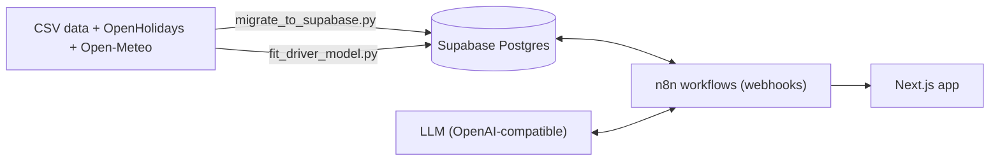

# Paznaun-Ischgl Demand Intelligence

A tool that looks at the gap between forecast and actual overnight stays in Paznaun-Ischgl, works out why the gap exists, and suggests campaigns to close it.

I built it at the TTF Hackathon 2026 for the challenge "Overnight Data Without Explanation" (TVB Paznaun-Ischgl). The people who would use it are the tourism director and the marketing team, so the output is written in plain language, not as statistics.

The short version of how it works:

1. Compare actual stays with the forecast and with last year, and classify the difference.
2. Fit a small regression model on calendar effects (weekday, Easter, school holidays per market, snow) and split the gap into those effects plus a leftover that stays unexplained.
3. Give those numbers to an LLM, which only writes the explanation. It can't change the numbers, and a check removes any figure it makes up.
4. Take the explanation and propose up to three campaigns, aimed at a future period, with a launch-by date based on how early people usually book.

## What's in the app

- **Dashboard:** KPIs, a demand timeline, a week table, a holiday calendar, a comparison with other Austrian regions, and a data-quality view.
- **Explain:** pick a day, week or range and get up to three reasons with evidence. You can vote on reasons, add context and ask for a reanalysis (up to 5 versions).
- **Alerts:** rules that look forward, for example "next month's forecast is 8% below last year", each with an act-by date.
- **Strategies:** up to three campaign options, or your own idea, which gets structured and checked against the data. You vote, reanalyse, then choose or dismiss.
- English and German UI.

## How it fits together



| Part | Tech |
|---|---|
| Frontend | Next.js 16, React 19, TypeScript, Tailwind 4 |
| Backend | n8n workflows exposed as webhooks, Code nodes for the logic |
| Database | Supabase (Postgres) with row level security |
| Model | Ridge regression in plain Python, block bootstrap for confidence intervals |
| LLM | Any OpenAI-compatible chat completions endpoint (I used gpt-4.1-mini) |

The n8n side is documented node by node in [N8N_WORKFLOWS.md](N8N_WORKFLOWS.md).

## Setup

### What you need

- Node.js 20.9 or newer
- Python 3.9 or newer
- `psql` (the PostgreSQL client) on your PATH
- A Supabase project (any Postgres 15 should work, no extensions are needed) and its connection string
- An n8n instance with an API key, and an OpenAI-compatible LLM endpoint

### 1. Clone and configure

```bash
git clone <your-repo-url>
cd <your-repo>
cp .env.example .env.local
cp frontend-starter/.env.local.example frontend-starter/.env.local
```

Fill in `.env.local` in the repo root:

| Variable | What it is |
|---|---|
| `SUPABASE_DB_URL` | Postgres connection string, `postgresql://postgres:<password>@<host>:5432/postgres` |
| `N8N_BASE_URL` | Your n8n address, without `/webhook` |
| `N8N_API_KEY` | n8n, Settings, n8n API, Create an API key |
| `N8N_POSTGRES_CREDENTIAL_ID` | Id of the Postgres credential in n8n (step 4) |
| `N8N_LLM_CREDENTIAL_ID` | Id of the LLM credential in n8n (step 4) |

And in `frontend-starter/.env.local`:

| Variable | What it is |
|---|---|
| `NEXT_PUBLIC_N8N_WEBHOOK_BASE` | `https://<your-n8n>/webhook` |

`.env.local` files are git-ignored. Anything starting with `NEXT_PUBLIC_` ends up in the browser, so never put a secret there.

### 2. Python

The scripts only use the standard library, so there's nothing to install for the core setup. `requirements.txt` lists a few optional extras:

```bash
pip install -r requirements.txt     # optional
```

`certifi` helps on macOS python.org builds that have no CA certificates. `playwright`, `edge-tts` and `imageio-ffmpeg` are only for the screenshots and video in `presentation/`. If you want those, also run `playwright install chromium`.

### 3. Database and data

Create the tables first, then load the data.

```bash
python3 scripts/setup_db.py                       # runs supabase/*.sql in order
python3 scripts/migrate_to_supabase.py --enrich   # loads the CSVs, holidays and weather
python3 scripts/migrate_to_supabase.py --verify   # prints row counts and KPIs to check the load
python3 scripts/fit_driver_model.py               # fits the driver model and stores it
```

A few notes:

- `setup_db.py` is safe to run again. Use `--dry-run` to see the file order.
- `migrate_to_supabase.py` on its own only applies `01_schema.sql`, which is why `setup_db.py` comes first. It truncates and reloads the `team_07_*` tables each time. `--dry-run` parses the files without touching the database.
- The source data isn't in the repo. Get the challenge datasets from the TTF Data Space and put them under `data/`. The folder names and file names the script expects are at the top of `scripts/migrate_to_supabase.py`.
- `fit_driver_model.py --dry-run` fits and backtests without writing anything.
- All tables are called `team_07_*`. If you want a different prefix, replace it in `supabase/`, `scripts/` and `workflows/` consistently.

### 4. n8n workflows

In the n8n editor, create two credentials:

1. A **Postgres** credential pointing at your Supabase database.
2. An **OpenAI** credential for your chat completions endpoint (base URL and key).

Open each one and copy its id from the address bar (`.../credentials/<id>`) into `.env.local`.

Then create the workflows from the JSON files in `workflows/`:

```bash
python3 scripts/import_workflows.py --dry-run     # no network, shows what would be created
python3 scripts/import_workflows.py --activate    # creates and publishes them
```

This script uses the n8n public API, fills in the credential ids, and points the demo workflow at your n8n. It skips workflows that already exist by name, and `--update` overwrites them. `--all` also imports the two old prototypes (`enrich`, `reason-tool`). I haven't run it against a live n8n yet, so check the result in the editor after the first run.

If you'd rather do it by hand, use "Import from File" in n8n for each file and pick the credentials on the nodes.

One thing to know: `workflows/agent.json` is behind the live version. The alert-rule nodes (`rules`, `rule_save`, `rule_delete`, `check` and the hourly trigger) aren't in it. Their SQL is in `workflows/agent-sql/`, and N8N_WORKFLOWS.md describes them. If you can, re-export that workflow from your n8n and replace the file.

Check that it works:

```bash
curl https://<your-n8n>/webhook/team-07-overview
curl -X POST https://<your-n8n>/webhook/team-07-agent \
  -H 'Content-Type: application/json' \
  -d '{"action":"explain","scope":"week","week":"2026-W16"}'
```

### 5. Run the app

```bash
npm --prefix frontend-starter install
npm --prefix frontend-starter run dev       # http://localhost:3000
npm --prefix frontend-starter run build     # production build
```

If n8n doesn't answer, the dashboard falls back to a saved snapshot (`frontend-starter/public/demo/overview.json`) and shows a "Demo snapshot" badge.

### Optional: agent connection files

The repo also has config for coding agents (Claude Code, Codex, OpenCode) that talk to the hackathon hub. They contain a personal token, so they're not meant to be committed. Copy the examples and add your own token if you use them:

```bash
cp .mcp.json.example .mcp.json
cp opencode.json.example opencode.json
cp .codex/config.toml.example .codex/config.toml
```

You don't need these to run the project.

## How the reasoning works

**Change type.** For each day there are three numbers: last year, the forecast and the actual. With a 5% tolerance, the combination gives a type such as `real_drop`, `forecast_too_high`, `expected_drop` or `no_change`. This happens in code before any AI call. "The forecast already expected this drop" counts as a valid answer, and `no_change` skips the LLM entirely.

**Driver model.** `scripts/fit_driver_model.py` fits

```
log(stays + 1) = season calendar + weekday + Easter + Christmas/New Year
               + school holidays per source market + new snow + season level + error
```

on about two years of daily data using ridge regression, solved with Gaussian elimination so it needs no numpy. A block bootstrap by week gives confidence intervals. Every driver is known ahead of time, so the same model can explain a past gap and a forecast gap. The workflow splits the change versus last year into one contribution per driver plus a residual, and those always add up to the gap.

**Facts and wording.** SQL builds a numbered fact pack (totals, weekday mix, holidays, events, weather, lead times, free beds, regional index). The LLM only gets that pack. It can't query the database.

**Guardrails** (all in Code nodes, not just the prompt):

- A reason needs at least one valid fact id, otherwise it's dropped.
- Every number in the generated text is matched against the fact pack. A sentence with an unknown number is removed and the item is flagged.
- "Not enough evidence" is an allowed answer, shown as the unexplained share.
- At most one of the three reasons may be a hypothesis (something the data can't show, like a lift outage). It always has low confidence.
- Confidence is capped, because the data has no source-market split.
- Markets, channels and KPIs come from fixed lists, and the model can't set dates.
- User feedback is limited to 500 characters and passed as data, not as instructions.

## How the campaign suggestions work

Campaigns always target the future. A gap in the past maps to the same period next season, aligned by Easter if Easter explains it (2026-W16 becomes 2027-W14). A forecast period is used as it is.

The launch-by date is the target start minus the booking lead time, taken as the point by which half of all bookings are in. If that date has passed, the plan says it's late and leans on last-minute offers.

Drops use a "recover" mode (holiday markets, last-minute pushes, packages, event hooks). Rises use a "capitalise" mode (protect prices, move demand into weaker neighbouring weeks).

## Data

| Source | Used for | Licence |
|---|---|---|
| TVB Paznaun-Ischgl via TTF Data Space | stays, free beds, lead time, events | challenge data, not in the repo |
| Contwise Paznaun content | events and hosts | CC-BY items only |
| JOANNEUM regional index | comparison with other regions | open |
| OpenHolidays | school and public holidays | ODbL |
| Open-Meteo | weather and snow | CC BY 4.0 |

Actuals end on 2026-10-31. There's no personal guest data anywhere.

## Evaluation

`workflows/agent-eval/cases.json` has labelled periods, for example Easter moving out of 2026-W16, which should give a calendar driver as the top reason.

```bash
python3 scripts/eval_agent.py            # fresh answers, one LLM call per case
python3 scripts/eval_agent.py --cached   # reuse saved answers
```

It checks the top reason, whether a symptom was wrongly given as a cause, the change type and the unexplained share.

## Project layout

| Path | What's there |
|---|---|
| `frontend-starter/` | the Next.js app |
| `workflows/` | n8n workflow exports, plus the SQL and JS of the larger nodes |
| `supabase/` | table definitions |
| `scripts/` | `setup_db.py`, `migrate_to_supabase.py`, `fit_driver_model.py`, `import_workflows.py`, `eval_agent.py` |
| `data/` | local source data (git-ignored) |
| `presentation/` | screenshot and video scripts for the pitch |
| `PLAN.md`, `AGENT_PLAN.md`, `STRATEGY_PLAN.md` | design notes |

## Limitations

- The data has no breakdown by source country, so market-specific ideas rest on holiday calendars and assumptions.
- Two years of history is little. Effects like Easter rest on very few observations, which is why the confidence intervals are shown.
- Campaigns stop at "suggest and choose". There's no text generation or sending step.
- Weather further out than 16 days is reported as a gap, not guessed.
- This is a prototype and uses a shared hackathon database.

## Licence

MIT, see `LICENSE`. Third-party licences are in `ATTRIBUTION.md`.
